# Sovereign Flow / SovaFlow

**저자 / 프로젝트 크레딧:** [Hee-sung Kang · 강희성](https://ikoffices.com/) · [Do-won Lee · 이도원](https://music.bugs.co.kr/artist/80353758?wl_ref=list_ar_02_search) · [Sungmo Park · 박성모](mailto:vividsaebom@gmail.com)

[조직](https://github.com/Sovereign-Music-Lab) · [웹사이트](https://sovereign-music-lab.github.io/) · [DeepChord](https://github.com/Sovereign-Music-Lab/DeepChord) · [Sovereign DAW](https://github.com/Sovereign-Music-Lab/sovaroll-DAW) · [Sovereign Flow](https://github.com/Sovereign-Music-Lab/SovaFlow)

## 초록
[English](README.md) · **한국어**

SovaFlow는 **DeepChord**(로컬 LLM 작곡), **Sovereign DAW / SovaRoll**(편집 가능한 MIDI·오디오 작업 프로그램), **사람의 피드백**을 하나의 반복 가능한 순환으로 잇습니다. 작곡 → DAW로 가져오기 → 듣기 → 피드백 → 다음 버전. 단계마다 *무엇을 요청했는지*, *무엇을 제안했는지*, *프로그램이 무엇을 받아들였는지*, *무엇이 검증됐는지*, *사람이 실제로 무엇을 들었는지*를 구분한 근거를 남깁니다. 없는 프로그램은 "사용 불가"로 기록하고 절대 꾸미지 않습니다.

0.1.0은 Node.js 22 이상에서 **의존성 없이** 동작합니다. 내장 합성 어댑터로 다른 프로그램 없이 전체 순환을 연습할 수 있고, DeepChord·SovaRoll 어댑터는 선택입니다.

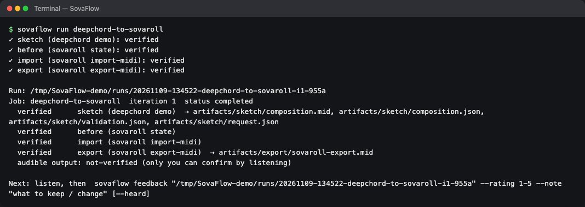

## 목차

- [하는 일](#하는-일)
- [설치 — 프로그래밍 몰라도 됩니다](#설치--프로그래밍-몰라도-됩니다)
- [매일의 사용 루틴](#매일의-사용-루틴)
- [메뉴 쓰기](#메뉴-쓰기)
- [명령](#명령)
- [DeepChord와 SovaRoll 연결](#deepchord와-sovaroll-연결)
- [작업과 근거(계약)](#작업과-근거계약)
- [업데이트와 삭제](#업데이트와-삭제)
- [독립 실행](#독립-실행)
- [개발과 테스트](#개발과-테스트)
- [라이선스](#라이선스)
- [개발 인계](#개발-인계)

## 하는 일

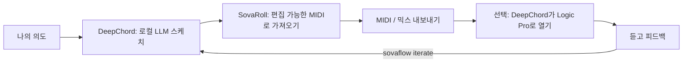

| 역할 | 프로그램 | 필수? |
|---|---|---|
| 작곡 스케치 | DeepChord (`deepchord demo`는 오프라인, `compose`는 내 로컬 모델 필요) | 선택 |
| 편집 작업 | 실행 중인 SovaRoll (`Start SovaRoll.command`) | 선택 |
| 최종 제작 | Logic Pro — DeepChord의 문서화된 `logic open`으로만 연결 | 선택 |
| 순환·근거·피드백·버전 | SovaFlow | — |

## 설치 — 프로그래밍 몰라도 됩니다

1. <https://nodejs.org>에서 **Node.js 22 이상**(LTS 설치 파일)을 설치합니다.
2. SovaFlow 내려받기: 초록색 **Code** 버튼 → **Download ZIP**, 압축을 풀고 `SovaFlow` 폴더를 고정된 곳에 둡니다. (Git: `git clone https://github.com/Sovereign-Music-Lab/SovaFlow.git`)
3. 시작:
   - **macOS**: **`Start SovaFlow.command`** 더블클릭(처음에는 오른쪽 클릭 → **열기** → **열기**).
   - **Windows**: **`Start SovaFlow.bat`** 더블클릭.
   - **터미널**: `node bin/sovaflow.mjs menu`(또는 `npm start`).

시스템 전체에 설치되는 것은 없습니다. SovaFlow는 홈 폴더의 **`Music/SovaFlow`** 한 곳에만 씁니다(`--home` 또는 `SOVAFLOW_HOME`으로 변경).

## 매일의 사용 루틴

| 단계 | 메뉴 | 명령 |
|---|---|---|
| 1. 쓸 수 있는 프로그램 점검 | 1 | `sovaflow doctor` |
| 2. 작업 미리 보기 — 아무것도 바꾸지 않음 | 3(먼저 계획을 보여 줌) | `sovaflow run 작업 --dry-run` |
| 3. 실행 | 2 또는 3 | `sovaflow run 작업` |
| 4. SovaRoll / Logic에서 듣고 평가 | 5 | `sovaflow feedback 실행 --rating 1-5 --note "..." [--heard]` |
| 5. 다음 버전 만들기 | 6 | `sovaflow iterate 실행` |
| 6. 돌아보기 | 4 | `sovaflow status [실행]` |

점수가 작업의 목표에 닿거나, 최대 반복 횟수에 이르거나, `--stop`을 붙이면 순환이 스스로 멈춥니다.

## 메뉴 쓰기

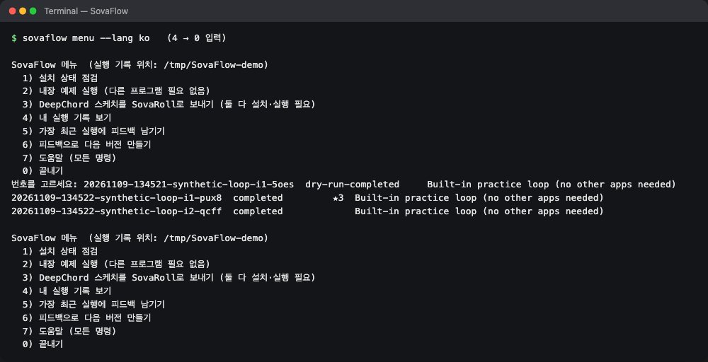

시스템 언어가 한국어면(또는 `--lang ko`) 메뉴가 한국어로, 아니면 영어로 나옵니다. 번호를 고르고 Enter, **0**은 끝내기입니다.

## 명령

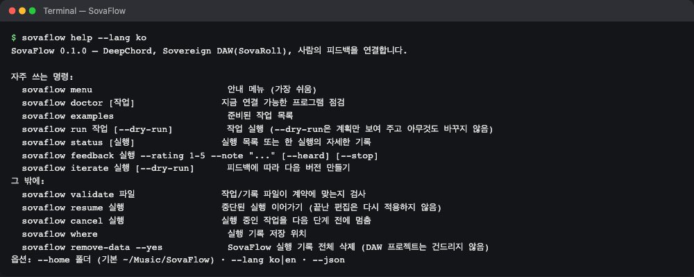

아래 `sovaflow`는 SovaFlow 폴더 안에서 `node bin/sovaflow.mjs`를 실행한다는 뜻입니다.

**설치 상태 점검**

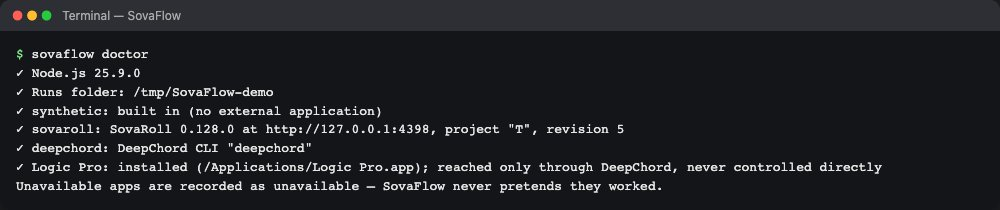

**준비된 작업**(`examples/`):

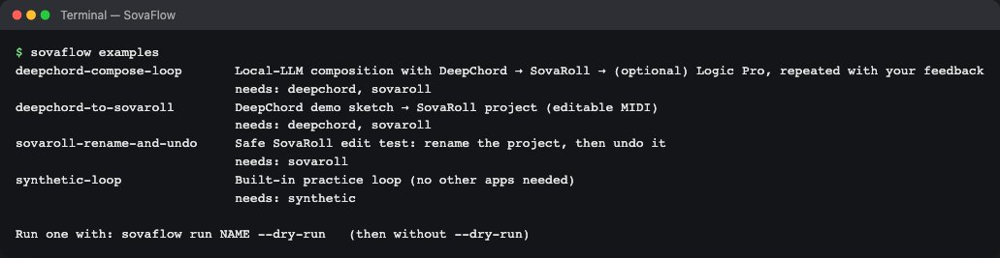

| 작업 | 필요 | 하는 일 |
|---|---|---|
| `synthetic-loop` | 없음 | 합성 표시가 붙은 4마디 MIDI 스케치를 쓰고 피드백·반복을 연습 |
| `deepchord-to-sovaroll` | DeepChord + 실행 중인 SovaRoll | `deepchord demo` → SovaRoll에 새 MIDI 트랙으로 가져오기 → MIDI 다시 내보내기 |
| `deepchord-compose-loop` | 로컬 모델이 있는 DeepChord + SovaRoll(+ Logic) | 로컬 LLM 작곡 → SovaRoll → Logic Pro 열기 요청, 피드백으로 반복 |
| `sovaroll-rename-and-undo` | 실행 중인 SovaRoll | 안전 시험: 검증된 편집 → 확인 → 되돌리기 |

**미리 보기, 실행, 피드백, 다음 버전**

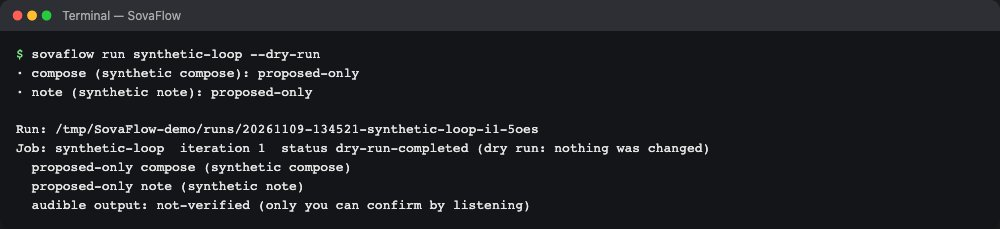

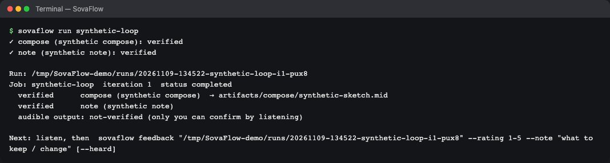

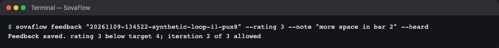

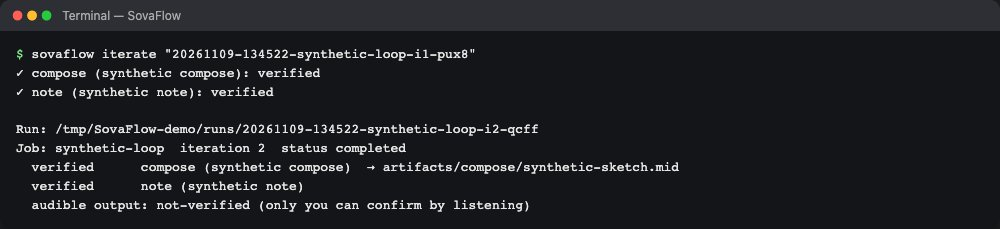

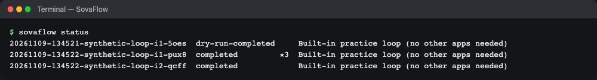

그 밖의 명령: `validate 파일`(작업/기록 검사), `resume 실행`(중단된 실행 이어가기, 끝난 편집은 다시 적용하지 않음), `cancel 실행`(다음 단계 전에 멈춤), `where`(실행 기록 폴더), `remove-data --yes`(SovaFlow 실행 기록 전체 삭제).

## DeepChord와 SovaRoll 연결

1. **SovaRoll**: 평소처럼 시작합니다(`http://127.0.0.1:4317`). 다른 포트라면 작업에 `"adapters": {"sovaroll": {"url": "http://127.0.0.1:4318"}}`를 쓰거나 `SOVAFLOW_SOVAROLL_URL`을 설정합니다.
2. **DeepChord**: 터미널에서 `deepchord`가 실행되도록 설치하거나, `"adapters": {"deepchord": {"command": "/경로/deepchord"}}` 또는 `SOVAFLOW_DEEPCHORD`를 설정합니다.
3. `sovaflow doctor` → `sovaflow run deepchord-to-sovaroll --dry-run` → `--dry-run` 없이 실행.

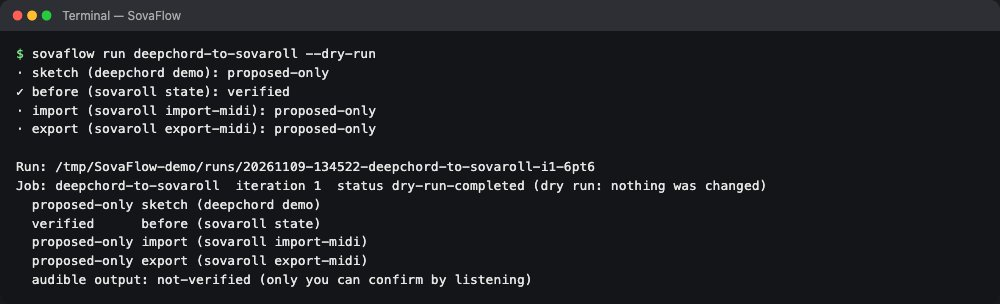

SovaFlow가 각 프로그램에 하는 일 — 그 이상은 하지 않습니다.

| 프로그램 | 작업 | 안전장치 |
|---|---|---|
| SovaRoll | `state`, `import-midi`, `command`(먼저 SovaRoll 자체 dry-run으로 검증), `export-midi`, `undo`(같은 실행에서 한 편집만) | 모든 쓰기에 기대 리비전과 문서 ID를 보내 바뀐 프로젝트는 편집하지 않음. 편집 하나 = SovaRoll 실행 취소 한 단계. 그사이 다른 편집이 있으면 undo 거부 |
| DeepChord | `demo`, `compose`, `validate`, `feedback`, `logic-open` | DeepChord의 문서화된 CLI만 사용. `compose`는 이전 반복의 결과를 `--previous-run`으로 넘김 |
| Logic Pro | `deepchord logic open`으로만 | 최대 **accepted**로 기록: 파일을 연 것은 가져오기나 소리의 증거가 아님 |

## 작업과 근거(계약)

**작업**(`sovaflow.job/1`)은 원하는 것과 시도할 단계를, **기록**(`sovaflow.record/1`, 실행 폴더의 `record.json`)은 실제로 일어난 일을 적습니다. 단계는 근거가 허락하는 만큼만 올라갑니다.

`requested` → `proposed` → `accepted` → `verified` — 또는 `unavailable`, `failed`, `cancelled`, `skipped`, `proposed-only`(dry run)로 끝납니다.

결과물(MIDI, JSON)은 SHA-256 해시와 함께 실행 폴더로 **복사**되고, 원본 파일은 옮기거나 고치지 않습니다. **들린 소리**는 `not-verified`로 시작해, `--heard`로 피드백을 남겼을 때만 `human-heard`가 됩니다. 전체 명세: [docs/CONTRACT.ko.md](docs/CONTRACT.ko.md) · [English](docs/CONTRACT.en.md).

실행 폴더 모습:

```
Music/SovaFlow/runs/20261109-134503-deepchord-to-sovaroll-i1-5wvq/
  job.json          실행한 작업 그대로
  record.json       단계 상태, 근거, 리비전, 피드백
  feedback.jsonl    피드백 이력
  artifacts/        복사한 결과물(composition.mid, sovaroll-export.mid …)
  work/             어댑터 작업 파일
```

## 업데이트와 삭제

**업데이트:** SovaFlow 폴더를 새로 받은 것으로 바꿉니다(Git: `git pull --ff-only`). `Music/SovaFlow`의 실행 기록은 그 밖에 있습니다.

**삭제:**
1. 선택: `sovaflow remove-data`는 실행 기록 폴더 크기를 보여 주고, `sovaflow remove-data --yes`는 지웁니다. (SovaRoll 프로젝트, DeepChord 결과, Logic 프로젝트는 다른 곳에 있어 지워지지 않습니다.)
2. `SovaFlow` 폴더를 휴지통으로 옮깁니다.

SovaFlow는 서비스·로그인 항목·패키지를 설치하지 않습니다.

## 독립 실행

Sovereign의 각 프로젝트는 혼자서 동작합니다. SovaFlow의 핵심·계약·테스트는 다른 저장소, LLM, 데이터셋, Logic Pro, 네트워크가 필요 없습니다. 어댑터는 작업이 요청할 때만 쓰고, 없으면 정직하게 기록합니다. DeepChord와 SovaRoll도 SovaFlow에 의존하지 않습니다.

## 개발과 테스트

```sh
npm test        # 테스트 10개: 계약, 합성 순환, 피드백/반복, SovaRoll 어댑터(테스트 대역), DeepChord 어댑터(테스트 대역), 취소/재개, CLI
```

2026-11-09에 실제 SovaRoll 0.129 서버와 실제 DeepChord CLI(`deepchord demo`)로도 확인했습니다: 가져오기 검증, MIDI 내보내기 검증, 이름 변경 + 되돌리기 검증. 실제 로컬 모델로 `deepchord compose`, Logic Pro 열기는 실행하지 않았습니다. 터미널 그림은 `scripts/capture-terminal.mjs`가 실제 출력으로 만듭니다. 설계와 작업 목록: [TASKS.md](TASKS.md), [docs/CONTRACT.ko.md](docs/CONTRACT.ko.md).

## 라이선스

[Apache-2.0](LICENSE) · [NOTICE](NOTICE). 외부 프로그램, 모델, 사용자 콘텐츠는 각자의 조건을 따릅니다. 모델 운영 방침은 라이선스를 제한하지 않습니다.

## 개발 인계

[CONTEXT.md](CONTEXT.md) · [AGENTS.md](AGENTS.md) · [TASKS.md](TASKS.md) · [Model operations / 모델 운영](docs/MODEL_OPERATIONS.ko.md) · [Reusable skill / 재사용 스킬](skills/model-tier-handoff/SKILL.md)
