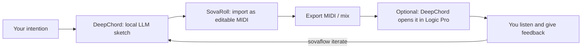

# Sovereign Flow / SovaFlow

**Authors / Project credits:** [Hee-sung Kang · 강희성](https://ikoffices.com/) · [Do-won Lee · 이도원](https://music.bugs.co.kr/artist/80353758?wl_ref=list_ar_02_search) · [Sungmo Park · 박성모](mailto:vividsaebom@gmail.com)

[Organization](https://github.com/Sovereign-Music-Lab) · [Website](https://sovereign-music-lab.github.io/) · [DeepChord](https://github.com/Sovereign-Music-Lab/DeepChord) · [Sovereign DAW](https://github.com/Sovereign-Music-Lab/sovaroll-DAW) · [Sovereign Flow](https://github.com/Sovereign-Music-Lab/SovaFlow)

## Abstract
**English** · [한국어](README.ko.md)

SovaFlow connects **DeepChord** (local-LLM composition), **Sovereign DAW / SovaRoll** (editable MIDI/audio workstation) and **your feedback** into one repeatable loop: compose → bring into the DAW → listen → give feedback → make the next version. Every step leaves evidence that separates *what was asked*, *what was proposed*, *what an app accepted*, *what was verified* and *what a human actually heard*. Missing apps are reported as unavailable — never faked.

Version 0.1.0 runs on Node.js 22+ with **no dependencies**. A built-in synthetic adapter lets you practise the whole loop with no other program installed; the DeepChord and SovaRoll adapters are optional.

## Contents

- [What it does](#what-it-does)
- [Install — no programming needed](#install--no-programming-needed)
- [Your daily routine](#your-daily-routine)
- [Using the menu](#using-the-menu)
- [Commands](#commands)
- [Connecting DeepChord and SovaRoll](#connecting-deepchord-and-sovaroll)
- [Jobs and evidence (the contract)](#jobs-and-evidence-the-contract)
- [Update or uninstall](#update-or-uninstall)
- [Independent operation](#independent-operation)
- [Development and tests](#development-and-tests)
- [License](#license)
- [Development handoff](#development-handoff)

## What it does



| Role | Program | Required? |
|---|---|---|
| Composition sketch | DeepChord (`deepchord demo` works offline; `compose` needs your local model) | Optional |
| Editing workstation | SovaRoll, already running (`Start SovaRoll.command`) | Optional |
| Final production | Logic Pro, reached only through DeepChord's documented `logic open` | Optional |
| Loop, evidence, feedback, versions | SovaFlow | — |

## Install — no programming needed

1. Install **Node.js 22 or newer** from <https://nodejs.org> (LTS installer).
2. Download SovaFlow: green **Code** button → **Download ZIP**, unpack, and move the `SovaFlow` folder somewhere permanent. (Git: `git clone https://github.com/Sovereign-Music-Lab/SovaFlow.git`.)
3. Start it:
   - **macOS**: double-click **`Start SovaFlow.command`** (first time: right-click → **Open** → **Open**).
   - **Windows**: double-click **`Start SovaFlow.bat`**.
   - **Terminal**: `node bin/sovaflow.mjs menu` (or `npm start`).

Nothing is installed system-wide. SovaFlow writes only to one folder: **`Music/SovaFlow`** in your home folder (change it with `--home` or `SOVAFLOW_HOME`).

## Your daily routine

| Step | Menu | Command |
|---|---|---|
| 1. Check what is available | 1 | `sovaflow doctor` |
| 2. Preview a job — changes nothing | 3 (shows the plan first) | `sovaflow run JOB --dry-run` |
| 3. Run it | 2 or 3 | `sovaflow run JOB` |
| 4. Listen in SovaRoll / Logic, then rate it | 5 | `sovaflow feedback RUN --rating 1-5 --note "..." [--heard]` |
| 5. Make the next version | 6 | `sovaflow iterate RUN` |
| 6. Look back | 4 | `sovaflow status [RUN]` |

The loop stops by itself when your rating reaches the job's target, when the maximum number of iterations is reached, or when you add `--stop`.

## Using the menu

```sh
node bin/sovaflow.mjs menu --lang en
```

The menu offers setup checks, a built-in example, DeepChord → SovaRoll, run history, feedback, the next version, and help.

The menu speaks Korean when your system language is Korean (or with `--lang ko`) and English otherwise. Choose a number and press Enter; **0** quits.

## Commands

Run these commands inside the SovaFlow folder. If your terminal starts elsewhere, first use `cd` to enter that folder.

```sh
node bin/sovaflow.mjs --help
```

Elsewhere in this guide, `sovaflow` is shorthand for `node bin/sovaflow.mjs`. Use the full command when running without a separate installation.

**Check your setup**

```sh
node bin/sovaflow.mjs doctor
```

**Ready-made jobs** (in `examples/`):

```sh
node bin/sovaflow.mjs examples
```

| Job | Needs | What it does |
|---|---|---|
| `synthetic-loop` | nothing | Writes a labelled synthetic 4-bar MIDI sketch; practise feedback and iteration |
| `deepchord-to-sovaroll` | DeepChord + running SovaRoll | `deepchord demo` → import into SovaRoll as new MIDI tracks → export MIDI back |
| `deepchord-compose-loop` | DeepChord with your local model + SovaRoll (+ Logic) | Local-LLM composition → SovaRoll → Logic Pro open request; repeat with feedback |
| `sovaroll-rename-and-undo` | running SovaRoll | Safety test: validated edit, verified, then undone |

**Dry run, run, feedback, next version**

```sh
node bin/sovaflow.mjs run synthetic-loop --dry-run
node bin/sovaflow.mjs run synthetic-loop
node bin/sovaflow.mjs status
```

Replace `RUN` below with the run ID shown by `status`. Add `--heard` only after you have listened to the result.

```sh
node bin/sovaflow.mjs feedback RUN --rating 4 --note "Softer melody" --heard
node bin/sovaflow.mjs iterate RUN
node bin/sovaflow.mjs status RUN
```

Other commands: `validate FILE` (check a job/record), `resume RUN` (continue an interrupted run; finished edits are never applied twice), `cancel RUN` (stop before the next step), `where` (show the runs folder), `remove-data --yes` (delete all SovaFlow runs).

## Connecting DeepChord and SovaRoll

1. **SovaRoll**: start it as usual (it listens on `http://127.0.0.1:4317`). For another port, set `"adapters": {"sovaroll": {"url": "http://127.0.0.1:4318"}}` in the job or `SOVAFLOW_SOVAROLL_URL`.
2. **DeepChord**: install it so `deepchord` runs in a terminal, or set `"adapters": {"deepchord": {"command": "/path/to/deepchord"}}` or `SOVAFLOW_DEEPCHORD`.
3. Run `sovaflow doctor`, then `sovaflow run deepchord-to-sovaroll --dry-run`, then without `--dry-run`.

What SovaFlow does with each app — and nothing more:

| App | Actions | Safety |
|---|---|---|
| SovaRoll | `state`, `import-midi`, `command` (validated with SovaRoll's own dry run first), `export-midi`, `undo` (of an edit made in the same run) | Every write sends the expected revision and document ID; a changed project is never edited; each edit is one SovaRoll Undo step; undo refuses if someone else edited in between |
| DeepChord | `demo`, `compose`, `validate`, `feedback`, `logic-open` | Uses only DeepChord's documented CLI; `compose` passes the previous iteration's run as `--previous-run` |
| Logic Pro | via `deepchord logic open` only | Recorded as **accepted** at most: opening a file is not proof of import or sound |

## Jobs and evidence (the contract)

A **job** (`sovaflow.job/1`) says what you want and which steps to try. A **record** (`sovaflow.record/1`, saved as `record.json` in each run folder) says what really happened. Each step climbs only as far as evidence allows:

`requested` → `proposed` → `accepted` → `verified` — or ends `unavailable`, `failed`, `cancelled`, `skipped`, `proposed-only` (dry run).

Artifacts (MIDI, JSON) are **copied** into the run folder with a SHA-256 hash; original files are never moved or edited. **Audible output** starts as `not-verified` and becomes `human-heard` only when you give feedback with `--heard`. Full specification: [docs/CONTRACT.en.md](docs/CONTRACT.en.md) · [한국어](docs/CONTRACT.ko.md).

A run folder looks like this:

```
Music/SovaFlow/runs/20261109-134503-deepchord-to-sovaroll-i1-5wvq/
  job.json          the job exactly as run
  record.json       step states, evidence, revisions, feedback
  feedback.jsonl    your feedback history
  artifacts/        copied outputs (composition.mid, sovaroll-export.mid …)
  work/             adapter working files
```

## Update or uninstall

**Update:** replace the SovaFlow folder with the new download (Git: `git pull --ff-only`). Your runs in `Music/SovaFlow` are outside it.

**Uninstall:**
1. Optional: `sovaflow remove-data` shows the size of your runs folder; `sovaflow remove-data --yes` deletes it. (Your SovaRoll projects, DeepChord runs and Logic projects live elsewhere and are not touched.)
2. Move the `SovaFlow` folder to the Trash.

SovaFlow installs no services, login items or packages.

## Independent operation

Each Sovereign project works on its own. SovaFlow's core, contract and tests need no sibling checkout, LLM, dataset, Logic Pro or network; adapters are used only when a job asks for them, and their absence is recorded honestly. DeepChord and SovaRoll do not depend on SovaFlow.

## Development and tests

```sh
npm test        # 10 tests: contract, synthetic loop, feedback/iteration, SovaRoll adapter (test double), DeepChord adapter (test double), cancel/resume, CLI
```

Verified on 2026-11-09 additionally against a real SovaRoll 0.129 server and the real DeepChord CLI (`deepchord demo`): import verified, MIDI export verified, rename + undo verified. `deepchord compose` with a real local model and Logic Pro opening were not exercised. Design and queue: [TASKS.md](TASKS.md), [docs/CONTRACT.en.md](docs/CONTRACT.en.md).

## License

[Apache-2.0](LICENSE) · [NOTICE](NOTICE). External applications, models and user content keep their own terms. Model-routing policies do not restrict the license.

## Development handoff

[CONTEXT.md](CONTEXT.md) · [AGENTS.md](AGENTS.md) · [TASKS.md](TASKS.md) · [Model operations / 모델 운영](docs/MODEL_OPERATIONS.en.md) · [Reusable skill / 재사용 스킬](skills/model-tier-handoff/SKILL.md)
