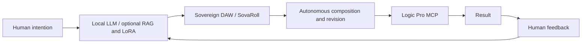

# Sovereign Flow / SovaFlow

**Authors / Project credits:** [Hee-sung Kang · 강희성](https://ikoffices.com/) · [Do-won Lee · 이도원](https://music.bugs.co.kr/artist/80353758?wl_ref=list_ar_02_search) · [Sungmo Park · 박성모](mailto:vividsaebom@gmail.com)

[Organization](https://github.com/Sovereign-Music-Lab) · [Website](https://sovereign-music-lab.github.io/) · [DeepChord](https://github.com/Sovereign-Music-Lab/DeepChord) · [Sovereign DAW](https://github.com/Sovereign-Music-Lab/sovaroll-DAW) · [Sovereign Flow](https://github.com/Sovereign-Music-Lab/SovaFlow)

## Abstract
**English** · [한국어](README.ko.md)

An independent orchestration project for the human–local-LLM–Sovereign-DAW–Logic-Pro feedback loop. This initial repository publishes the design and Gemma handoff; it does not yet contain an executable orchestration engine.

## Contents

- [Product roles](#product-roles)
- [Workflow](#workflow)
- [Independent operation](#independent-operation)
- [Get started](#get-started)
- [Development operations](#development-operations)
- [License](#license)
- [Development handoff](#development-handoff)

## Product roles

- Sovereign DAW / SovaRoll: the professional-grade open-source DAW project, with editable MIDI/audio and its own standalone runtime.
- DeepChord: use a local LLM to compose while working with Logic Pro. Current MCP observation and handoff capabilities have their own documented limits.
- Sovereign Flow: coordinate the two through explicit, optional interfaces and human feedback.

## Workflow



The loop is the target architecture. Autonomous composition must preserve editable sources and distinguish a requested action, accepted action, verified import, audible output, and human quality judgment. A request accepted by an MCP endpoint is not proof of a completed musical result.

## Independent operation

Each repository owns its essential implementation. Integration must use versioned adapters and declared capabilities; no sibling checkout or private dataset should be required just to inspect, test, or run a future standalone SovaFlow core. Optional integrations can require the corresponding application when enabled.

Start with a self-contained dry-run adapter and synthetic fixtures. Do not imply that the current documentation-only release can run the full loop.

## Get started

```sh
git clone https://github.com/Sovereign-Music-Lab/SovaFlow.git
cd SovaFlow
```

Read [CONTEXT.md](CONTEXT.md), [AGENTS.md](AGENTS.md), and [TASKS.md](TASKS.md). There is no runtime installation or start command yet. A human must choose the first implementation task. To remove this documentation checkout, move the folder to Trash after preserving any local edits.

## Development operations

The immediate receiving environment is local Gemma 4 26B / MLX on the user's M5 Pro 24 GB machine. Exact model ID, quantization and usable context remain to be measured. [English operations](docs/MODEL_OPERATIONS.en.md) · [한국어 운영 방법](docs/MODEL_OPERATIONS.ko.md) · [Reusable skill](skills/model-tier-handoff/SKILL.md).

## License

[Apache-2.0](LICENSE) · [NOTICE](NOTICE). External applications, models and user content keep their own terms. Model-routing policies do not restrict the license.

## Development handoff

[CONTEXT.md](CONTEXT.md) · [Model operations / 모델 운영](docs/MODEL_OPERATIONS.en.md) · [Reusable skill / 재사용 스킬](skills/model-tier-handoff/SKILL.md)
